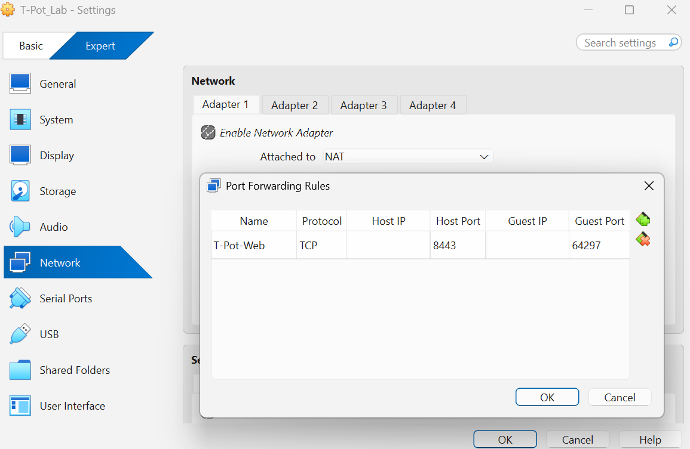
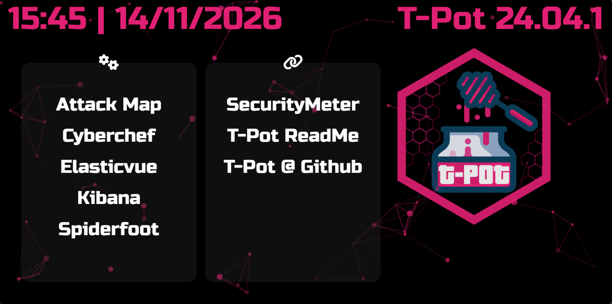

# T-Pot Honeypot Lab – Configuration & Deployment

## ⚙️ CONFIGURATION OVERVIEW

After installing T-Pot Community Edition, the environment was configured to allow access to the honeypot platform and its web-based monitoring interface.

The deployment uses Oracle VirtualBox with Ubuntu Server as the guest operating system. VirtualBox networking was configured using NAT with port forwarding to provide access to the T-Pot web interface from the Windows host.

## 🌐 NETWORK CONFIGURATION

### VirtualBox Network Settings

The virtual machine uses **NAT (Network Address Translation)** networking.

A port forwarding rule was configured with the following settings:

| Setting | Configuration |
|---|---|
| Network Adapter | NAT |
| Host Port | 8443 |
| Guest Port | 64297 |
  

This configuration allows the host machine to access the T-Pot web interface through the forwarded port.

### Web Interface Access

After configuring port forwarding, the T-Pot web interface was accessed through a web browser on the host machine.

The local browser address used was:

`https://localhost:8443`

 

Successful access to the interface confirmed that the web-based management environment was reachable.

## 🐳 T-POT ENVIRONMENT

T-Pot uses Docker to deploy and manage its honeypot services and supporting components.

The environment provides a centralized platform for collecting and visualizing network activity generated by interactions with the deployed honeypots.

The installed version was also verified through the T-Pot Git repository.

**Version verification command:**

```bash
cd ~/tpotce
git describe --tags
```

**Output:**

```text
24.04.1-180-g5d95017d
```

## ✅ DEPLOYMENT VERIFICATION

The following checks were performed to verify the deployment:

- Successfully accessed the Ubuntu Server command-line environment.
- Verified the installed T-Pot version through the local Git repository.
- Accessed the T-Pot web interface through the configured port forwarding rule.
- Navigated to the T-Pot main interface.


<sub>T-Pot web interface showing successful access to the deployed platform.</sub>
## 🔐 SECURITY CONSIDERATIONS

Sensitive configuration details, including login credentials and private network information, are excluded from this documentation.
