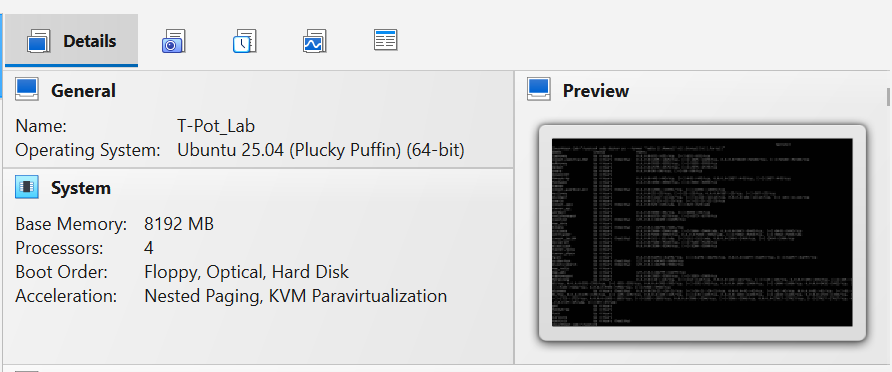
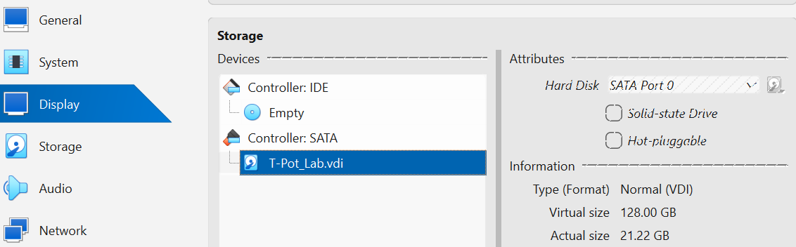
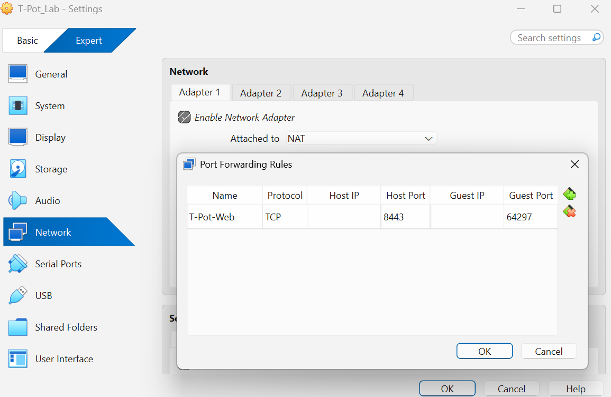

# T-Pot Honeypot Lab – Installation & Configuration

## 🧰 PREREQUISITES

The following hardware and software were used to deploy the lab environment.

### Hardware & Software

- **Host Operating System:** Windows 11
- **Virtualization Platform:** Oracle VirtualBox
- **Guest Operating System:** Ubuntu Server
- **Honeypot Platform:** T-Pot Community Edition
- **Internet Connection:** Required for installation, updates, and deployment

## 💻 VIRTUAL MACHINE CONFIGURATION

Created a virtual machine in Oracle VirtualBox to host the T-Pot environment. The following resources were allocated to support Ubuntu Server and the T-Pot deployment.

| Configuration | Specification |
|---|---|
| Virtual Machine Name | `T-Pot_Lab` |
| Operating System | Ubuntu Server (64-bit) |
| CPU Allocation | 4 CPUs |
| Memory Allocation | 8 GB RAM |
| Virtual Disk | 128 GB |
| Network Adapter | NAT |



<sub>VirtualBox virtual machine configuration showing the allocated system resources.</sub>



<sub>VirtualBox storage configuration showing the virtual disk allocation.</sub>

## 🐧 UBUNTU SERVER & T-POT INSTALLATION

Installed Ubuntu Server as the guest operating system within the VirtualBox environment.

After preparing the Ubuntu environment, deployed **T-Pot Community Edition**, which uses Docker to manage its honeypot services and supporting components.

The installed T-Pot version was verified through the local Git repository.

**Version verification command:**

```bash
cd ~/tpotce
git describe --tags
```

**Output:**

```text
24.04.1-180-g5d95017d
```

## 🌐 NETWORK CONFIGURATION

The virtual machine uses **NAT (Network Address Translation)** networking. A port forwarding rule was configured to allow the Windows host machine to access the T-Pot web interface.

| Setting | Configuration |
|---|---|
| Network Adapter | NAT |
| Host Port | 8443 |
| Guest Port | 64297 |



<sub>VirtualBox NAT port forwarding configuration.</sub>

## 🖥️ WEB INTERFACE ACCESS

After configuring port forwarding, accessed the T-Pot web interface through a browser on the Windows host machine.

**Local browser address:**

`https://localhost:8443`


<sub>T-Pot web interface showing successful access to the deployed platform.</sub>

## ✅ DEPLOYMENT VERIFICATION

The following checks were completed to verify the deployment:

- Confirmed the Ubuntu Server virtual machine boots and accepts login credentials.
- Accessed the Ubuntu Server command-line environment.
- Verified the installed T-Pot version through the local Git repository.
- Successfully accessed the T-Pot web interface through the configured port forwarding rule.
- Navigated to the T-Pot main interface.

## 🔐 SECURITY CONSIDERATIONS

Sensitive configuration details, including login credentials and private network information, are excluded from this documentation.
